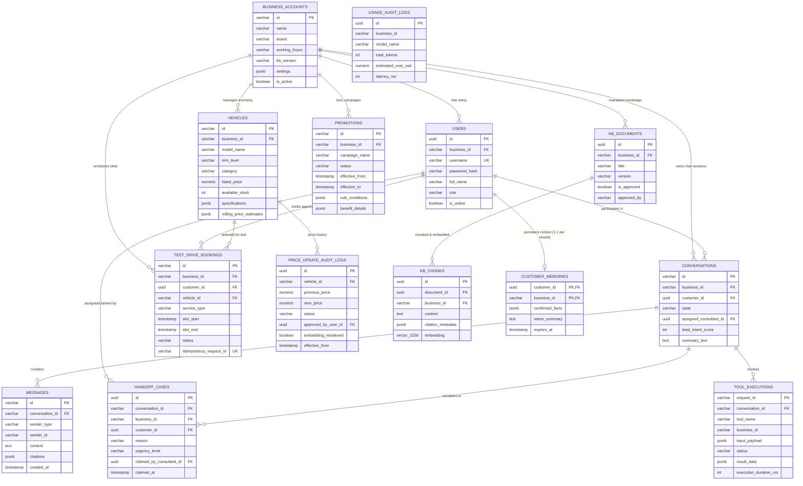

# THIẾT KẾ MÔ HÌNH THỰC THỂ LIÊN KẾT (ENTITY RELATIONSHIP DIAGRAM - ERD)

**Dự án:** Hệ Thống AI Automation & Agentic Workflow Cho Showroom Ô Tô  
**Hệ CSDL:** PostgreSQL 16 + pgvector  
**Chuẩn thiết kế:** 3NF, Zero Data Leakage (Multi-tenancy isolation), Idempotency Tool Execution Ledger.

---

## 1. Biểu Đồ Quan Hệ Thực Thể (ERD - Mermaid Diagram)

---

## 2. Giải Thích 7 Miền Dữ Liệu Cốt Lõi

1. **Multi-Tenancy & Identity:** Cách ly dữ liệu cấp độ bản ghi (Row-Level / Tenant Foreign Key). Mỗi Showroom là một tenant độc lập với cài đặt thời gian biểu, kho tài liệu và nhân sự riêng biệt.
2. **Vehicle & Inventory Management:** Quản lý danh mục xe, phiên bản, giá niêm yết và tạm tính giá lăn bánh theo tỉnh/thành phố. Bảng `price_update_audit_logs` kiểm soát quy trình 4 mắt (Four-eyes principle) khi thay đổi giá xe.
3. **Promotion & Dynamic Rule Engine:** Lưu trữ các chiến dịch khuyến mãi có cấu trúc JSONB linh hoạt, lọc theo hạng khách hàng, dòng xe, khu vực địa lý và hình thức thanh toán.
4. **Knowledge Base (RAG & pgvector):** Lưu trữ tài liệu chính thức đã được ban giám đốc phê duyệt, chia nhỏ thành các chunk kèm vector nhúng cosine 1536 chiều được đánh chỉ mục `HNSW`.
5. **Conversation, State & Working Memory:** Quản lý vòng đời hội thoại (`AI_ACTIVE` -> `HANDOFF_PENDING` -> `HUMAN_ACTIVE` -> `RESOLVED`), lưu trữ ngữ cảnh khách hàng định danh trong 24 giờ.
6. **Booking & Lead Escalation (Handoff):** Xử lý đặt lịch tư vấn và lái thử xe với khóa chống trùng lặp (`idempotency_request_id`), phân bổ ca trực cho chuyên viên tư vấn khi phát hiện khách hàng nóng hoặc yêu cầu thương lượng giá.
7. **Idempotency Tool Execution Ledger & Audit:** Ghi nhận mọi lệnh gọi công cụ vào cơ sở dữ liệu để ngăn ngừa tình trạng gọi lặp (double booking/double ticket) và theo dõi chi phí API token chi tiết.
