# Kiến trúc hệ thống, luồng nghiệp vụ và kế hoạch đánh giá MVP AutoAdvisor

**Phiên bản:** 1.0 — 27/09/2026  
**Phạm vi:** showroom ô tô, hai vai trò `CUSTOMER` và `EMPLOYEE`, một chatbot điều phối, Booking Agent, Reminder Agent và human-in-the-loop.  
**Trạng thái:** kiến trúc đã chốt; MVP đã triển khai và kiểm thử trong repository này.

---

## 1. Kết luận điều hành

Giải pháp phù hợp nhất không phải một hệ thống nhiều LLM-agent tự tranh luận. Với năm nhánh nghiệp vụ rõ, phương án ít rủi ro hơn là **modular monolith + deterministic state machine + một LLM có structured output + các tool nghiệp vụ do backend kiểm soát**.

- Frontend production: **React + TypeScript**.
- Backend production: **Node.js + TypeScript**, tách module nhưng triển khai một khối ở giai đoạn MVP.
- Database production: **PostgreSQL + pgvector**; Redis chỉ thêm khi cần queue/realtime/cache phân tán.
- Chatbot: **Gemini 3.8 Flash** làm model khởi điểm, gọi trực tiếp Gemini hoặc qua OpenRouter; `gemini-embedding-2` cho semantic search/clustering. Model luôn là cấu hình và phải vượt bộ eval trước khi đổi.
- Giao dịch đặt lịch, phân quyền, chống trùng, idempotency, SLA, gửi reminder và handoff là **code/DB**, không giao quyền quyết định cuối cho LLM.
- MVP local: React/TypeScript + Node/TypeScript + SQLite file-backed để chạy ngay, không cần cài PostgreSQL. Đây là adapter demo, không phải lựa chọn DB production.

Điểm quan trọng nhất: hệ thống không cố thay thế nhân viên ngay. AI xử lý câu hỏi lặp, thu thập nhu cầu và đặt lịch; con người xử lý thương lượng, khiếu nại, dữ liệu thiếu và ngoại lệ. Đây là cách human-in-the-loop có thể đo, kiểm soát và mở rộng dần.

---

## 2. Các task và trạng thái bàn giao

| Task | Đầu ra | Trạng thái |
|---|---|---|
| T1 — Phân tích pain point và hành trình | Hai actor, năm nhánh khách hàng, hai nhánh nhân viên, ranh giới AI/người | Hoàn thành |
| T2 — Nghiên cứu và chọn kiến trúc | ADR, stack, model, DB, security, deployment | Hoàn thành |
| T3 — Trực quan hóa | Context, container, state machine, sequence cho từng luồng, ERD, handoff ca, analytics | Hoàn thành trong tài liệu này |
| T4 — Xây MVP | Login/RBAC, chat tự do, năm route, booking, reminder outbox, queue, question mining, metrics | Hoàn thành |
| T5 — Kiểm thử theo role | Type-check, production build, integration tests | Hoàn thành; 4/4 nhóm test đạt |
| T6 — Đo và đánh giá | KPI, event schema, offline/online eval, ngưỡng go/no-go | Hoàn thành trong mục 16 |

---

## 3. Pain point cần giải quyết

### 3.1. Khách hàng

| Pain point | Hậu quả | Xử lý đề xuất |
|---|---|---|
| Hỏi đúng nhưng chatbot trả lời sai | Mất niềm tin, rủi ro tranh chấp giá/chính sách | Grounded answer, citation, confidence gate, nút phản hồi, correction flow |
| Muốn đặt lịch nhưng bot chỉ hướng dẫn | Mất “momentum”, khách phải đổi kênh | Booking Agent gọi tool thật, trả mã lịch và giờ xác nhận |
| Chờ nhân viên quá lâu trong giai đoạn nóng | Lead nguội hoặc sang đối thủ | AI phản hồi ngay; handoff SLA dưới 5 phút cho ca nóng |
| Bị hỏi lại thông tin khi chuyển người/đổi ca | Trải nghiệm rời rạc | Context brief gồm summary, facts, intent, việc tiếp theo, transcript link |
| Không biết AI làm được gì | Kỳ vọng sai | UI công khai route: đã trả lời, chỉ hướng dẫn, đặt lịch, chuyển người |

### 3.2. Nhân viên

| Pain point | Hậu quả | Xử lý đề xuất |
|---|---|---|
| Trả lời lặp lại hàng trăm câu giống nhau | Mệt mỏi, phản hồi chậm, nội dung thiếu nhất quán | Question mining → cụm câu hỏi → đáp án gợi ý đã duyệt |
| Hàng chờ không có ưu tiên | Bỏ lỡ lead nóng | Priority + SLA clock + intent/lead score |
| Đọc toàn bộ chat để hiểu ca | Tăng handle time | Context brief và recent facts trước transcript |
| Hai nhân viên cùng nhận một ca | Trùng chăm sóc | Atomic claim ở DB, một owner tại một thời điểm |
| Không biết booking có đến thật không | Không đo được conversion | Nhân viên xác nhận `ARRIVED/NO_SHOW`; funnel có denominator rõ |
| Giao ca mất ngữ cảnh | Nhân viên ca sau hỏi lại khách | Snapshot context có version, owner cũ/mới và audit event |

### 3.3. Vì sao ưu tiên “5 phút”

Nghiên cứu HBR năm 2011 trên lead online cho thấy tổ chức liên hệ trong vòng một giờ có khả năng qualify lead cao hơn rõ rệt so với liên hệ muộn hơn; nghiên cứu Lead Response Management liên quan cũng cho thấy mức suy giảm mạnh sau năm phút. Đây là bằng chứng tốt cho **giả thuyết speed-to-lead**, nhưng không phải bằng chứng nhân quả riêng cho showroom Việt Nam. Vì vậy dự án dùng “phản hồi có ý nghĩa dưới 5 phút” làm SLO/pilot hypothesis và đo lại trên dữ liệu showroom, không tuyên bố trước rằng tỷ lệ chốt xe chắc chắn tăng một mức cố định. Nguồn: [The Short Life of Online Sales Leads](https://thedenmangroupselling.wordpress.com/wp-content/uploads/2011/03/the-short-life-of-online-sales-leads-harvard-business-review.pdf), [Lead Response Management summary](https://cma-web.s3.ca-central-1.amazonaws.com/pdf/Harvard-Business-Review-LeadResponseMgmt-Study.pdf).

---

## 4. Quyết định kiến trúc và lý do vượt trội trong bối cảnh dự án

### 4.1. Modular monolith thay vì microservices

| Tiêu chí | Modular monolith | Microservices |
|---|---|---|
| Nhóm 3 người/MVP | Một repo, một deploy, debug xuyên luồng dễ | Tốn thời gian contract, discovery, deploy, observability |
| Booking transaction | Giao dịch DB trực tiếp, ít điểm lỗi | Cần distributed transaction/outbox/saga sớm |
| Tốc độ thay đổi domain | Refactor module nhanh | Contract versioning làm chậm thử nghiệm |
| Scale | Scale toàn app trước, tách worker sau | Scale độc lập tốt nhưng chưa cần ở tải MVP |

**Quyết định:** bắt đầu bằng modular monolith với ranh giới module rõ (`auth`, `conversation`, `orchestration`, `booking`, `handoff`, `reminder`, `analytics`). Chỉ tách Reminder Worker hoặc Retrieval Service khi metric cho thấy bottleneck. Lợi thế không phải “monolith luôn tốt hơn”, mà là **giảm coordination cost và giữ transaction đặt lịch đơn giản** ở giai đoạn còn đang tìm product-market fit.

### 4.2. Stateful workflow thay vì multi-agent tự trị

Năm route đã biết trước nên state machine cho tính quan sát, khả năng tái hiện và test regression tốt hơn. LLM chỉ xuất một `Decision` có schema; policy layer có thể từ chối hoặc đổi thành handoff. Booking và reminder là tool node, không phải “agent” tự do.

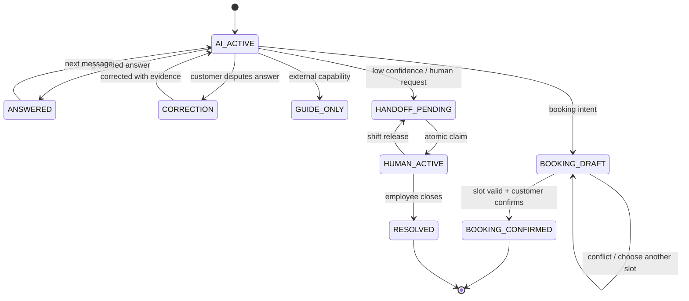

### 4.3. TypeScript end-to-end

**Frontend — React + TypeScript:** hai màn khách/nhân viên có nhiều trạng thái bất đồng bộ; component hóa giúp tái sử dụng message, booking, queue và metric. TypeScript làm API contract, union route và role kiểm tra được lúc build. React chính thức hỗ trợ TypeScript/TSX và typed props/hooks ([React TypeScript guide](https://react.dev/learn/typescript)).

**Backend — Node.js + TypeScript:** phù hợp I/O-bound workload gồm chat, LLM, email và DB; dùng chung type/JSON schema với frontend; một nhóm nhỏ không phải duy trì song song Python và TypeScript. Node hiện có hỗ trợ chạy TypeScript type-stripping; production vẫn phải chạy `tsc --noEmit` trong CI vì runtime không type-check ([Node.js TypeScript documentation](https://nodejs.org/download/release/v24.15.0/docs/api/typescript.html)).

**Vì sao không chọn Python/FastAPI trong lần triển khai này:** FastAPI là lựa chọn tốt nếu team có năng lực Python/ML mạnh, nhưng repo ban đầu là web JS và máy chạy không có Python. Với phạm vi chủ yếu là orchestration API, TypeScript giảm context switching và cho một vertical slice chạy ngay. Nếu sau này có pipeline ML/ETL nặng, có thể tách Python worker mà không đổi public API.

### 4.4. PostgreSQL + pgvector

PostgreSQL giữ user, conversation, message, booking, handoff, audit và analytics trong một nguồn nhất quán. Điểm vượt trội quan trọng nhất cho bài toán lịch là range/exclusion constraint có thể chặn overlap ngay ở DB, thay vì chỉ “check rồi insert” ở application — cách dễ race condition. PostgreSQL mô tả chính thức exclusion constraint cho non-overlapping ranges ([PostgreSQL range constraints](https://www.postgresql.org/docs/15/rangetypes.html)).

`pgvector` đặt embedding cạnh metadata/citation và transaction hiện có, tránh vận hành thêm vector database ở quy mô MVP. HNSW có trade-off speed/recall; cần đo recall và lưu ý filter theo tenant có thể làm giảm kết quả. Tài liệu pgvector khuyến nghị partition/separate table cho isolation/recall ở multi-tenant ([pgvector README](https://github.com/pgvector/pgvector)).

MVP local dùng `node:sqlite` file-backed để zero-setup; Node xác nhận `DatabaseSync` hỗ trợ DB file hoặc in-memory ([Node SQLite docs](https://nodejs.org/download/release/v22.12.0/docs/api/sqlite.html)). Khi production, migration sang PostgreSQL là bắt buộc vì concurrency, RLS, exclusion constraint và vận hành backup tốt hơn.

### 4.5. Model và provider

| Nhiệm vụ | Lựa chọn | Vì sao phù hợp | Guardrail |
|---|---|---|---|
| Route + soạn câu trả lời MVP | `gemini-3.8-flash` | Flash class phù hợp latency/volume; hỗ trợ structured output/tool use | JSON schema, temperature thấp, confidence threshold |
| Semantic RAG + gom câu hỏi | `gemini-embedding-2` | Multilingual, dùng cho retrieval/classification/clustering | version embedding/index, eval recall@k |
| Provider adapter | Gemini direct hoặc OpenRouter | Tránh khóa cứng một gateway; OpenRouter có routing/fallback | timeout, circuit breaker, audit provider/model |
| Business rules | Không dùng LLM | Giá, tồn kho, slot, auth cần kết quả xác định | DB transaction + validation |

Tại ngày tài liệu, Google mô tả Gemini 3.8 Flash là Flash model mới cho workflow phức tạp; model catalog thay đổi nên tên model nằm trong env, không viết cứng vào contract ([Gemini models](https://ai.google.dev/gemini-api/docs/models), [Gemini 3.8 Flash](https://ai.google.dev/gemini-api/docs/latest-model)). OpenRouter công bố slug `google/gemini-3.8-flash` và structured outputs; schema giúp giảm lỗi parse nhưng **không chứng minh nội dung đúng** ([OpenRouter model](https://openrouter.ai/google/gemini-3.8-flash), [structured outputs](https://openrouter.ai/docs/guides/features/structured-outputs)). Gemini function calling chỉ đề xuất lời gọi; application vẫn phải thực thi và kiểm tra tool ([Gemini tools](https://ai.google.dev/gemini-api/docs/tools)).

“Tối ưu” ở đây có nghĩa là đạt Pareto tốt nhất trên bộ eval nội bộ về chất lượng, p95 latency và chi phí — không phải khẳng định model tốt nhất tuyệt đối. Nếu model khác vượt scorecard, thay qua adapter mà không đổi logic nghiệp vụ.

---

## 5. Kiến trúc tổng thể

### 5.1. System context

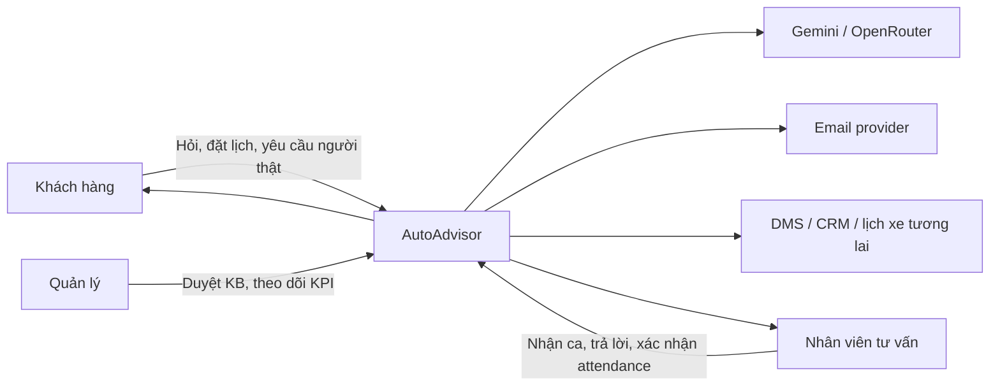

### 5.2. Container/component view

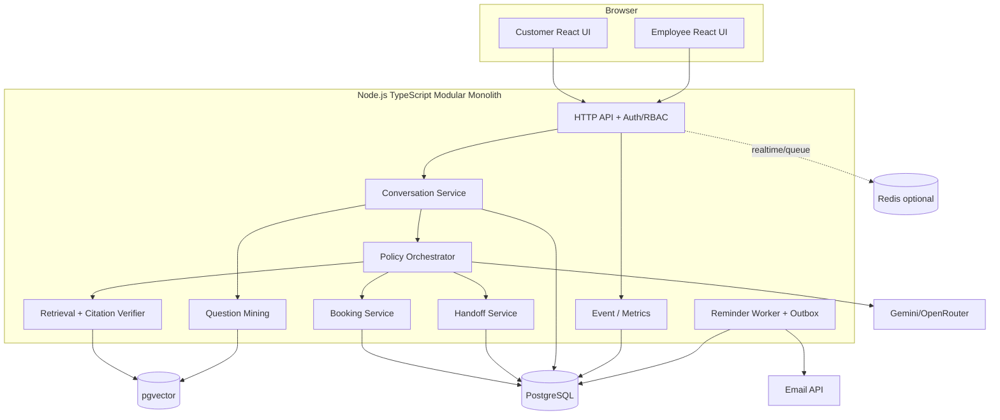

### 5.3. Nguyên tắc luồng request

1. API xác thực token và role trước khi đọc dữ liệu.
2. Conversation Service nạp state, recent messages và facts theo đúng customer/tenant.
3. Orchestrator lấy structured decision từ LLM hoặc policy fallback.
4. Policy kiểm tra route/confidence/evidence; LLM không tự gọi DB write.
5. Tool service validate input, authorization, idempotency và transaction.
6. Message, decision, provider, latency, tool result và event được lưu.
7. UI nhận answer cùng `route`/`action`; nhân viên nhận context brief nếu handoff.

---

## 6. Năm luồng của khách hàng

### Luồng 1 — Khách hỏi đúng, chatbot trả lời đúng

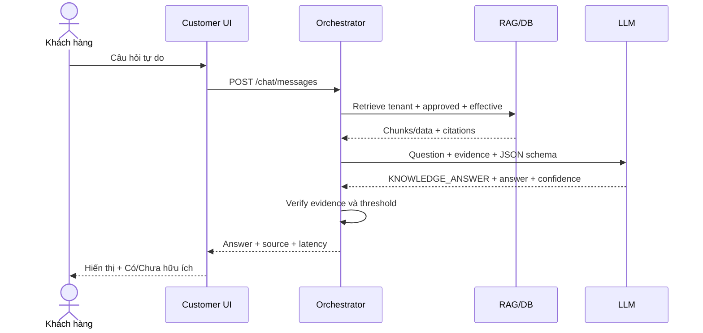

**Điều kiện thành công:** claim giá/tồn kho lấy từ tool/DB; nội dung catalog có citation; không đủ evidence thì không đi route này.

### Luồng 2 — Khách hỏi đúng, chatbot trả lời sai

```mermaid
sequenceDiagram
    actor C as Khách hàng
    participant UI as Customer UI
    participant O as Orchestrator
    participant V as Verifier
    participant H as Handoff Queue
    C->>UI: "Thông tin này sai" / bấm Chưa
    UI->>O: Feedback + message_id
    O->>V: So claim với source/tool result
    alt Có nguồn mới đủ mạnh
      V-->>O: Correction + citation/version
      O-->>UI: Xin lỗi + câu đính chính
    else Không đủ căn cứ hoặc rủi ro cao
      V-->>O: Verification failed
      O->>H: Tạo case ANSWER_DISPUTE + context
      O-->>UI: Không đoán; đã chuyển nhân viên
    end
```

**Không được làm:** lặp lại câu cũ, đổ lỗi khách, tự bịa nguồn. Feedback sai trở thành false-positive sample trong eval set.

### Luồng 3 — Khách đặt lịch, agent đặt được lịch

```mermaid
sequenceDiagram
    actor C as Khách hàng
    participant UI as Booking UI
    participant B as Booking Service
    participant DB as PostgreSQL
    participant R as Reminder Outbox
    C->>UI: Chọn xe/ngày/giờ + xác nhận
    UI->>B: POST /bookings + idempotency_key
    B->>DB: BEGIN; lock/check resource + consultant
    alt Slot còn trống
      B->>DB: INSERT booking CONFIRMED
      B->>DB: INSERT reminder -24h, -3h
      DB-->>B: COMMIT + booking_id
      B-->>UI: 201 confirmed
      R->>DB: Poll outbox theo scheduled_at
    else Slot bị chiếm
      DB-->>B: exclusion/conflict
      B-->>UI: 409 + yêu cầu chọn slot khác
    end
    UI-->>C: Mã lịch và thời gian xác nhận
```

Production nên dùng `tstzrange` và `EXCLUDE USING gist (resource_id WITH =, slot WITH &&)`; kiểm tra ở application chỉ để UX nhanh, constraint DB mới là hàng rào cuối.

### Luồng 4 — Agent chỉ hướng dẫn, không thể thực hiện giúp

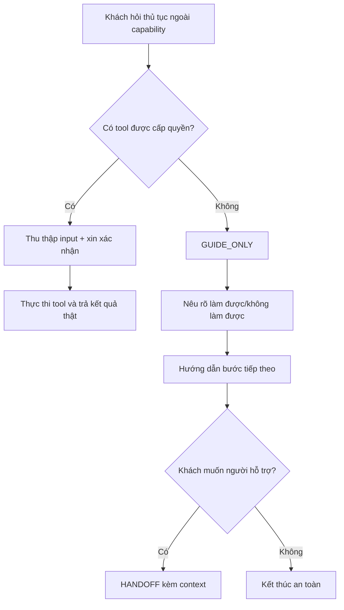

Ví dụ: AI hướng dẫn hồ sơ vay nhưng không thể phê duyệt thay ngân hàng. Việc mô tả giới hạn làm giảm “ảo tưởng tự động hóa” và tạo đường thoát rõ.

### Luồng 5 — Chuyển cho nhân viên

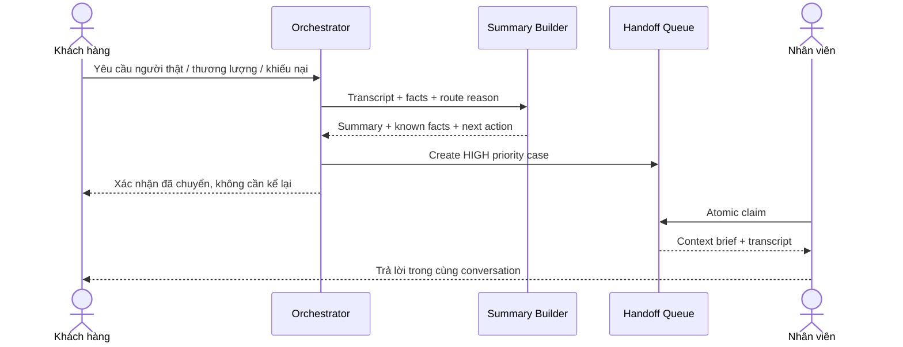

Trigger handoff: khách yêu cầu; confidence/evidence dưới ngưỡng; khiếu nại; thương lượng giá; write tool lỗi không xác định; prompt injection; nội dung nhạy cảm; SLA/capability exceeded.

---

## 7. Luồng nhân viên

### 7.1. Hàng chờ và câu trả lời gợi ý

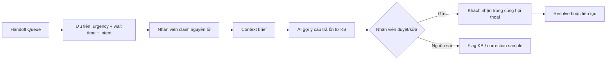

AI suggestion không tự gửi. Nhân viên là người chịu trách nhiệm ở `HUMAN_ACTIVE`.

### 7.2. Chuyển giao giữa hai ca

```mermaid
sequenceDiagram
    actor E1 as Nhân viên ca 1
    participant H as Handoff Service
    participant DB as Context Store
    actor E2 as Nhân viên ca 2
    E1->>H: Release/transfer + note
    H->>DB: Snapshot vN: summary, facts, commitments, next action
    H->>DB: Clear owner; state=HANDOFF_PENDING
    E2->>H: Claim case
    H->>DB: Compare-and-set owner=E2
    DB-->>E2: Context brief vN + recent transcript
    E2->>E2: Acknowledge context
    E2-->>H: Continue same conversation
```

Context brief bắt buộc gồm:

- khách là ai và xe quan tâm;
- câu hỏi/ý định hiện tại;
- facts đã xác nhận và nguồn/version;
- việc AI/nhân viên đã hứa;
- booking/tool status;
- cảm xúc/rủi ro;
- next best action và deadline;
- link transcript, không nhồi toàn transcript vào summary.

Summary phải version hóa; facts quan trọng như giá, lịch, số điện thoại lấy từ DB chứ không tin tuyệt đối vào text do LLM tóm tắt.

---

## 8. Gom câu hỏi trùng lặp và sinh đáp án hỗ trợ nhân viên

### 8.1. Phương pháp production

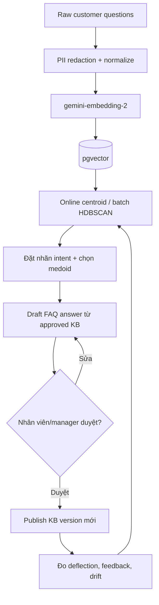

1. Bỏ chữ thừa, chuẩn hóa Unicode, model/phiên bản xe; redact phone/email/CCCD.
2. Tạo embedding và chỉ so trong cùng tenant, ngôn ngữ, time window.
3. MVP group theo `intent`; production chạy online centroid hằng giờ và batch clustering hằng đêm.
4. Dùng medoid — câu thật gần tâm cụm — làm đại diện, không dùng một câu LLM tự bịa.
5. Sinh draft answer chỉ từ KB đã duyệt, kèm source/version.
6. Nhân viên/manager duyệt trước khi publish thành canned answer.
7. Tách cụm khi silhouette thấp hoặc nội dung có nhiều ý; merge khi centroid similarity vượt ngưỡng đã tune.

Metric quan trọng: số câu/cụm, coverage top-N, cluster purity do người chấm, tỷ lệ nhân viên dùng gợi ý, edit distance trước khi gửi và accuracy sau publish. Embedding phù hợp cho clustering/semantic retrieval theo tài liệu Gemini ([Embeddings guide](https://ai.google.dev/gemini-api/docs/embeddings)).

### 8.2. MVP hiện tại

MVP dùng `decision.intent` làm `cluster_key`, tăng counter và lưu representative/suggested answer. Cách này dễ giải thích và đủ demo; chưa phải semantic clustering production.

---

## 9. Reminder Agent

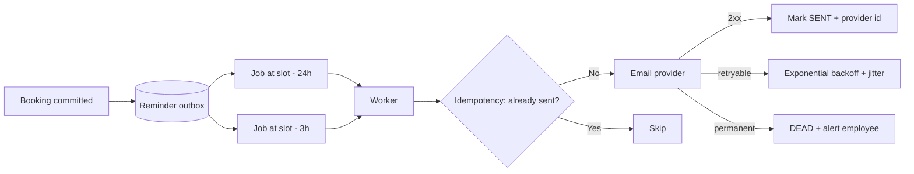

MVP tạo đúng hai outbox record. Worker quét mỗi phút; nếu có `RESEND_API_KEY` và `MAIL_FROM` thì gửi email thật, nếu chưa có thì ghi `SIMULATED` và audit log. Production dùng queue durable, retry có backoff/jitter và dead-letter queue; không chạy timer đơn lẻ trên nhiều replica nếu chưa có distributed lock.

---

## 10. Mô hình dữ liệu cốt lõi

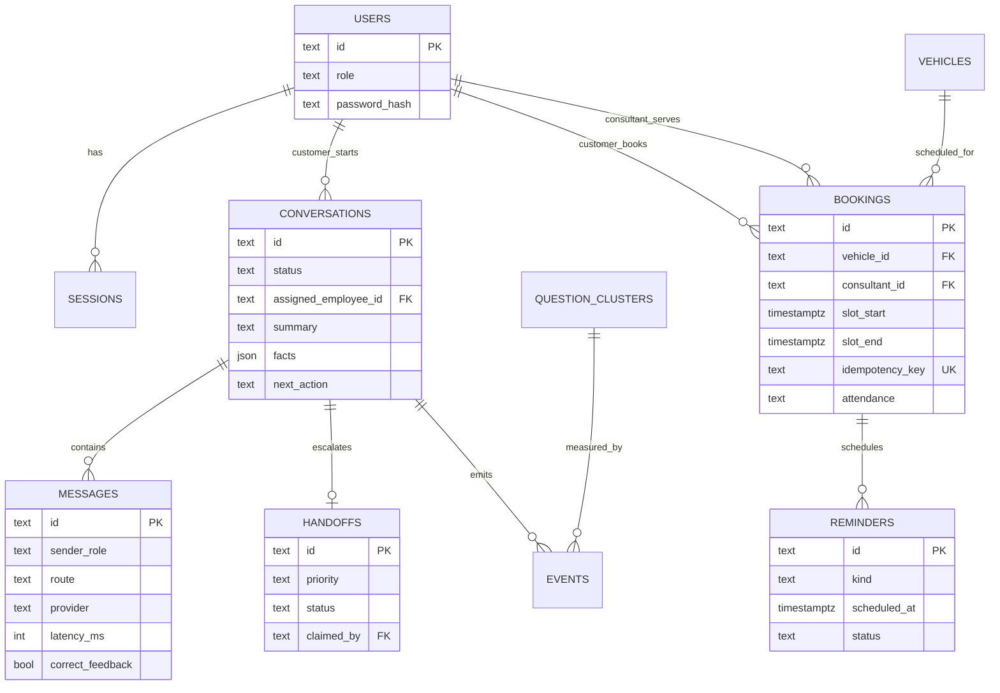

Production bổ sung `business_id` vào mọi aggregate, composite index theo tenant và PostgreSQL RLS. Khi RLS bật mà không có policy phù hợp, PostgreSQL dùng default-deny; đây là lớp defense-in-depth, không thay thế authorization ở API ([PostgreSQL Row Security](https://www.postgresql.org/docs/17/ddl-rowsecurity.html)).

---

## 11. API và contract chính

| Method | Endpoint | Role | Mục đích |
|---|---|---|---|
| POST | `/api/auth/login` | Public | Login, nhận opaque session token |
| GET | `/api/conversations/current` | Customer | Lấy conversation và message history |
| POST | `/api/chat/messages` | Customer | Câu hỏi tự do → một trong năm route |
| POST | `/api/messages/:id/feedback` | Customer | Đúng/sai cho từng answer |
| GET | `/api/bookings/availability` | Both | Slot trống theo xe/ngày |
| POST | `/api/bookings` | Customer | Đặt lịch idempotent, tạo reminder |
| GET | `/api/employee/queue` | Employee | Danh sách handoff có context brief |
| POST | `/api/employee/handoffs/:id/claim` | Employee | Claim nguyên tử |
| POST | `/api/employee/conversations/:id/messages` | Employee owner | Trả lời khách |
| GET | `/api/employee/bookings` | Employee | Lịch và attendance |
| PATCH | `/api/employee/bookings/:id/attendance` | Employee | ARRIVED/NO_SHOW/PENDING |
| GET | `/api/employee/insights` | Employee | Metrics, question clusters, reminders |

Decision contract tối thiểu:

```json
{
  "route": "KNOWLEDGE_ANSWER | CORRECTION | BOOKING | GUIDE_ONLY | HANDOFF",
  "intent": "vehicle_question",
  "answer": "...",
  "confidence": 0.94,
  "reason": "...",
  "missing_fields": []
}
```

LLM output chưa bao giờ là authorization. Backend tự suy ra user/tenant từ session và allowlist route/tool.

---

## 12. Bảo mật, độ tin cậy và dữ liệu cá nhân

- Password hash bằng scrypt/Argon2id; production ưu tiên cookie `HttpOnly`, `Secure`, `SameSite` hoặc token rotation. MVP dùng bearer token trong localStorage để đơn giản demo, không dùng nguyên trạng cho production.
- RBAC và ownership check ở từng endpoint; customer không gọi API employee; employee phải claim mới gửi message.
- API key chỉ ở `ui-demo/.env` phía server, không prefix `VITE_`, không đưa vào bundle/log.
- Prompt/KB/user text là untrusted input. Tool name, schema, tenant và permission đến từ server.
- Redact PII trước trace/embedding; raw transcript có retention và access audit.
- Booking dùng idempotency key và DB constraint; email dùng outbox/idempotency.
- Timeout/fallback cho provider; local policy không bịa câu trả lời khi mất LLM.
- Giá/khuyến mãi cần effective date, approval status và source version.
- OpenTelemetry phù hợp gom traces, metrics, logs theo chuẩn vendor-neutral ([OpenTelemetry docs](https://opentelemetry.io/docs/)).

---

## 13. Deployment production đề xuất

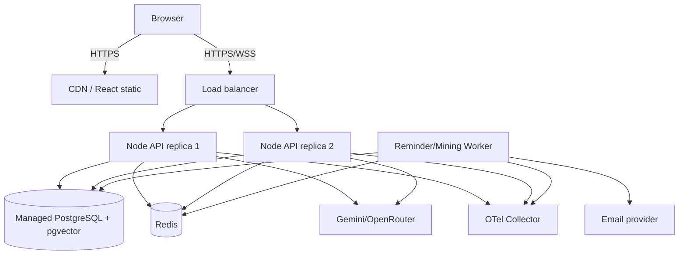

### Lộ trình scale

1. **MVP:** một Node process + SQLite; local/demo only.
2. **Pilot:** Node container + managed PostgreSQL/pgvector + email API; một API replica, worker riêng.
3. **Production:** nhiều replica, Redis queue/realtime, OTel, RLS, backup/PITR, WAF/rate limit.
4. **Chỉ khi có bằng chứng:** tách retrieval hoặc booking thành service riêng nếu ownership/scale/release cadence thực sự khác.

---

## 14. MVP đã triển khai

### 14.1. Mapping yêu cầu → code

| Yêu cầu | Cách MVP xử lý |
|---|---|
| Login hai role | `customer/demo123`, `employee/demo123`; backend RBAC |
| Câu hỏi không fix cứng | Text bất kỳ gửi `/api/chat/messages`; Gemini/OpenRouter structured decision, policy fallback khi không key/lỗi |
| Năm luồng | Năm route union và UI badge/action tương ứng |
| Agent đặt lịch | Availability API, transaction, consultant assignment, idempotency, conflict 409 |
| Agent nhắc email | Hai outbox record -24h/-3h; worker gửi thật nếu cấu hình mail, nếu không mô phỏng có audit |
| Nhân viên nhận câu hỏi | Queue, context brief, transcript, atomic claim, reply owner-only |
| Giao ca | Data model có owner/state/summary/facts/next action; API claim; production cần thêm release endpoint |
| Gom câu hỏi | Counter theo intent, representative và suggested answer trong Insights |
| Xác nhận khách đến | Employee cập nhật `ARRIVED/NO_SHOW/PENDING` |
| Đo chatbot | latency, route, provider, feedback, booking, handoff, reminder events |

### 14.2. Cấu trúc chạy

```text
backend/server.ts             API, SQLite schema, orchestration, agents, metrics
ui-demo/src/main.tsx          React UI hai role
ui-demo/src/styles.css        Responsive visual system
ui-demo/.env.example          Gemini/OpenRouter/mail configuration
tests/mvp.test.mjs            Integration tests
package.json                  build/run/test scripts
```

### 14.3. Cách chạy

```powershell
Copy-Item ui-demo/.env.example ui-demo/.env
# Điền GEMINI_API_KEY hoặc OPENROUTER_API_KEY nếu muốn dùng LLM thật.
npm install
npm run build
npm test
npm start
```

Mở `http://localhost:8080`. Có thể chạy `start.bat` để build, mở trình duyệt và start server.

Provider selection:

- Có `OPENROUTER_API_KEY` và không ép `MODEL_PROVIDER=gemini`: dùng OpenRouter.
- Nếu không có OpenRouter nhưng có `GEMINI_API_KEY`: dùng Gemini direct.
- Không có key hoặc provider timeout/error: `local-policy`/`local-fallback`; hệ thống vẫn chạy demo và ưu tiên handoff khi thiếu căn cứ.

### 14.4. Giới hạn MVP cần nói rõ

- SQLite chỉ phù hợp local/single process; chưa có PostgreSQL RLS/exclusion constraint thật.
- Kho dữ liệu chỉ có hai xe mẫu; chưa ingestion PDF/citation UI.
- Question mining mới group theo intent, chưa embeddings/clustering.
- Summary handoff đang deterministic, chưa có fact verification nâng cao.
- Realtime dùng polling 5 giây, chưa WebSocket.
- Session bearer localStorage và account demo không phải production auth.
- Reminder thật cần mail provider key/domain đã xác minh.
- Chưa tích hợp DMS/CRM/calendar thật; booking dùng DB nội bộ.

---

## 15. Kiểm thử và kết quả

Các lệnh đã chạy:

```text
npm run check  -> PASS
npm run build  -> PASS
npm test       -> 4/4 PASS
```

| Nhóm test | Kiểm chứng | Kết quả |
|---|---|---|
| RBAC | Customer bị 403 ở employee queue; employee được 200 | PASS |
| Năm route | Năm câu tự do lần lượt vào answer/booking/correction/guide/handoff | PASS |
| Booking | Tạo lịch 201, hai reminder, replay idempotent, slot trùng 409 | PASS |
| Handoff | Có summary; chưa claim không reply được; claim rồi reply được | PASS |

Trước pilot cần bổ sung: concurrent booking load test; provider timeout/rate-limit; prompt injection; PII redaction; cross-tenant negative test; DST/timezone; reminder retry/dead-letter; accessibility/browser test; recovery sau crash giữa tool call và commit.

---

## 16. Phương án đo lường và đánh giá chatbot

### 16.1. Không dùng một “accuracy” duy nhất

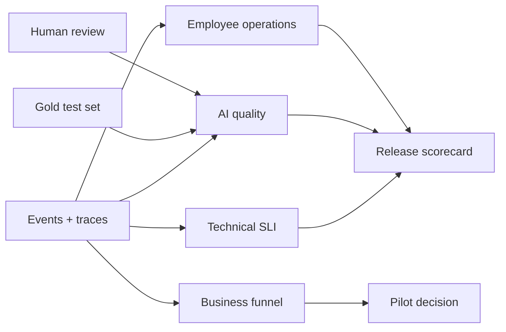

| Nhóm | Chỉ số | Công thức/định nghĩa | MVP thu ở đâu |
|---|---|---|---|
| Speed | p50/p95 response latency | `response_at - message_received_at` | `messages.latency_ms`, event |
| Route | Macro F1 năm route | trung bình F1 từng route trên gold set | offline evaluator |
| Correctness | Grounded answer accuracy | answer đúng và được source/tool support / answer eligible | feedback + human sample |
| Hallucination | Unsupported-claim rate | answer có claim không được evidence hỗ trợ / answer audited | human/LLM judge có calibration |
| Calibration | Selective accuracy | accuracy ở từng confidence bucket | decision + label |
| Booking | Booking success rate | confirmed / booking attempts hợp lệ | booking events |
| Safety | Duplicate booking rate | overlapping confirmed booking / total confirmed | phải bằng 0 |
| Handoff | Meaningful response ≤5m | handoff có human response ≤300s / handoff | handoff/message timestamp |
| Handoff | Context sufficiency | ca nhân viên không phải hỏi lại facts / ca audited | employee rating |
| Automation | Safe deflection | resolved by AI, đúng, không reopen 24h / eligible conversations | state + feedback |
| Question mining | Cluster coverage | questions thuộc top-N approved clusters / total questions | cluster assignment |
| Employee | Suggestion acceptance | suggestion gửi nguyên/sửa nhẹ / suggestions shown | UI events |
| Reminder | Delivery success | provider accepted / due reminders | reminder status |
| Business | Lead-to-booking | unique confirmed booking / qualified leads | events/bookings |
| Business | Show-up rate | ARRIVED / (ARRIVED + NO_SHOW) | attendance |
| Experience | CSAT | trung bình rating sau phiên | cần thêm survey |

### 16.2. Bộ dữ liệu chuẩn

Tạo tối thiểu 200 case đầu tiên, 40 case/route; mỗi case có:

- câu hỏi và 2–3 biến thể tiếng Việt/typo;
- conversation context cần thiết;
- expected route;
- expected tool call/không tool;
- required facts và forbidden claims;
- source/version;
- expected handoff reason;
- risk tag: giá, PII, booking, complaint, prompt injection.

Thêm 20% adversarial cases và mọi production failure đã xác nhận. Tách train/tuning set và locked regression set. Mỗi thay đổi model/prompt/KB/tool contract phải chạy lại locked set.

### 16.3. Quy trình đánh giá ba tầng

1. **Offline deterministic:** schema, route, citation exists, tool arguments, booking conflicts, RBAC.
2. **Offline semantic:** hai người chấm độc lập correctness/relevance/context sufficiency; LLM judge chỉ hỗ trợ, được calibration với người.
3. **Online pilot:** shadow/canary theo cohort, so với baseline nhân viên; theo dõi conversion nhưng không hy sinh safety.

### 16.4. Release gates đề xuất

| Gate | Ngưỡng ban đầu |
|---|---:|
| Cross-role/cross-tenant unauthorized access | 0 case |
| Confirmed booking overlap | 0 case |
| Fabricated booking success | 0 case |
| Route macro F1 | ≥ 0,85 |
| Grounded correctness toàn bộ | ≥ 90% |
| Giá/khuyến mãi correctness | 100% trên locked critical set |
| Unsupported-claim rate | < 2%; critical claim = 0 |
| p95 first meaningful response | ≤ 5 giây |
| Handoff context sufficiency | ≥ 90% |
| Reminder provider acceptance | ≥ 99% |

Ngưỡng business như booking rate/show-up rate không phải release gate kỹ thuật; đánh giá bằng pilot đủ mẫu và confidence interval. Không tối ưu “deflection” đơn độc vì bot có thể tăng deflection bằng cách trả lời sai thay vì handoff.

### 16.5. Event schema tối thiểu

```json
{
  "event_name": "chat_response",
  "trace_id": "...",
  "conversation_id": "...",
  "actor_role": "CUSTOMER",
  "route": "BOOKING",
  "provider": "gemini",
  "model_version": "gemini-3.8-flash",
  "prompt_version": "router-v1",
  "kb_version": "2026-09-01",
  "latency_ms": 842,
  "tool_status": "NOT_CALLED",
  "created_at": "ISO-8601"
}
```

Không đưa raw phone/email/message vào analytics payload. Giữ `trace_id` để join với secure trace store có quyền riêng.

---

## 17. Backlog production theo thứ tự

1. PostgreSQL migration, tenant key, RLS, booking exclusion constraint và Alembic/SQL migration tương đương.
2. Approved KB ingestion + hybrid retrieval + citation verification.
3. Durable outbox worker, provider email thật, retry/dead-letter và template quản trị.
4. Release/transfer shift endpoint, acknowledgment và employee context rating.
5. WebSocket/SSE cho chat/queue; Redis chỉ khi chạy nhiều replica.
6. Semantic question clustering + manager approval workflow.
7. OpenTelemetry, dashboards, alerting và data retention/redaction.
8. Gold dataset, evaluation CI, shadow/canary và pilot A/B.
9. DMS/CRM/calendar integration qua adapter; giữ idempotency/audit boundary.
10. Security review: OWASP ASVS/API, rate limit, CSRF/cookie auth, secrets manager, backup/restore drill.

---

## 18. Tài liệu tham khảo chính

- [React — Using TypeScript](https://react.dev/learn/typescript)
- [Node.js — TypeScript support](https://nodejs.org/download/release/v24.15.0/docs/api/typescript.html)
- [Node.js — SQLite](https://nodejs.org/download/release/v22.12.0/docs/api/sqlite.html)
- [PostgreSQL — Range types and non-overlap constraints](https://www.postgresql.org/docs/15/rangetypes.html)
- [PostgreSQL — Row security policies](https://www.postgresql.org/docs/17/ddl-rowsecurity.html)
- [pgvector — indexing, filtering and multi-tenancy](https://github.com/pgvector/pgvector)
- [Gemini — models](https://ai.google.dev/gemini-api/docs/models)
- [Gemini — tools/function calling](https://ai.google.dev/gemini-api/docs/tools)
- [Gemini — embeddings](https://ai.google.dev/gemini-api/docs/embeddings)
- [OpenRouter — structured outputs](https://openrouter.ai/docs/guides/features/structured-outputs)
- [OpenRouter — model fallbacks](https://openrouter.ai/docs/guides/routing/model-fallbacks)
- [OpenTelemetry documentation](https://opentelemetry.io/docs/)
- [Harvard Business Review — The Short Life of Online Sales Leads](https://thedenmangroupselling.wordpress.com/wp-content/uploads/2011/03/the-short-life-of-online-sales-leads-harvard-business-review.pdf)

