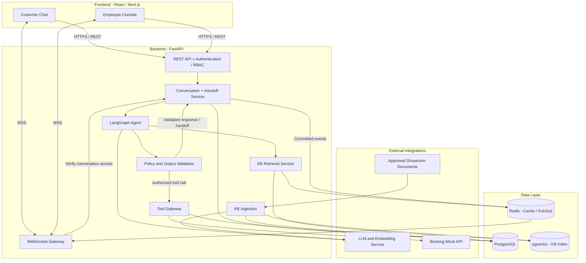
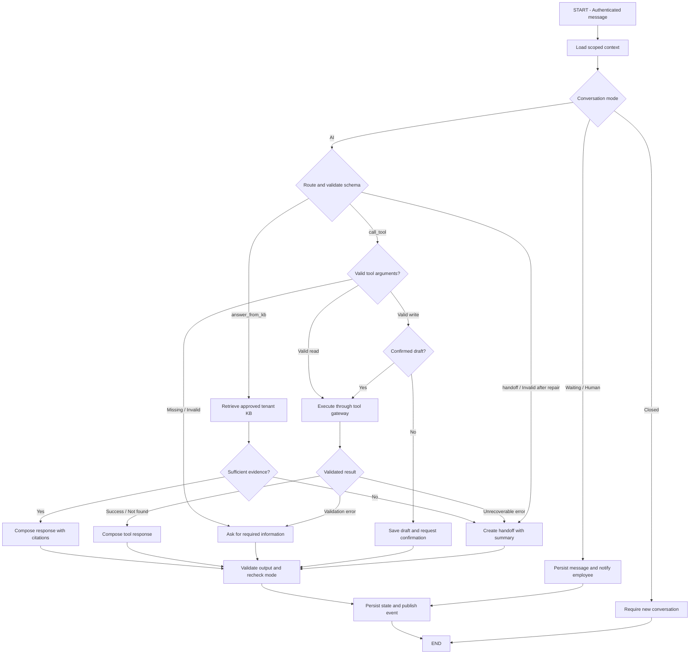
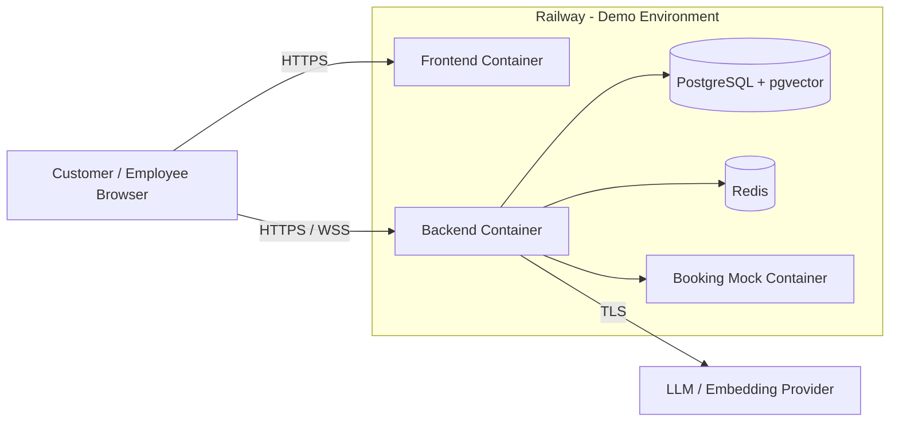

# Architecture Document

## System Overview

AI Agent Chatbot doanh nghiệp cung cấp dịch vụ chăm sóc khách hàng trong Business Account của showroom xe: tư vấn từ Knowledge Base (KB) có trích nguồn, đặt lịch tư vấn/lái thử và bàn giao hội thoại cho nhân viên. Hệ thống tổ chức theo kiến trúc phân lớp, gồm Frontend React/Next.js, Backend FastAPI, AI Agent LangGraph và lớp dữ liệu PostgreSQL/pgvector; REST phục vụ nghiệp vụ, WebSocket cập nhật hội thoại realtime. Backend kiểm soát phân quyền, cách ly tenant, xác nhận thao tác ghi và kết quả tool, còn LLM thực hiện phân loại ý định, chọn hướng xử lý và tạo phản hồi có căn cứ.

## Architecture Diagram

Backend là một ứng dụng chia module theo trách nhiệm. pgvector là extension trong cùng PostgreSQL; Redis lưu cache và phân phối event, còn PostgreSQL giữ dữ liệu nghiệp vụ bền vững. Booking mock được truy cập qua Tool Gateway để cô lập contract và mô phỏng các tình huống thành công, không tìm thấy, timeout và lỗi dịch vụ.

## Components

### 1. Frontend (React/Next.js)

- **Purpose:** Cung cấp giao diện khách hàng trò chuyện với Business Account và giao diện nhân viên tiếp quản hội thoại.
- **Key Features:**
  - Đăng nhập và hiển thị chức năng theo vai trò `customer` hoặc `employee`.
  - Customer Chat: gửi tin nhắn, xem lịch sử, mở citation, xác nhận lịch hẹn và theo dõi trạng thái bàn giao.
  - Employee Console: xem queue, lý do chuyển ca, thời gian chờ, summary, transcript và kết quả tool; nhận ca, trả lời và kết thúc ca.
  - Realtime qua WebSocket; reconnect tải lại message từ REST API, loại trùng theo message ID.
  - Hiển thị rõ AI mode, trạng thái chờ và human mode; thao tác chính dùng được bằng keyboard.
- **State Management:** React hooks quản lý form/draft; query cache quản lý dữ liệu server. Conversation status, owner và tool result luôn lấy từ backend; WebSocket cập nhật cache theo event ID/version.

### 2. Backend (FastAPI)

- **Purpose:** Xử lý nghiệp vụ, xác thực/phân quyền, điều phối agent, lưu hội thoại, quản lý handoff và phát event realtime.
- **API Design:** RESTful, validate request/response bằng Pydantic, trả lỗi chuẩn hóa và gắn `trace_id` xuyên suốt quá trình xử lý.
- **Authentication:** JWT với hai role `customer` và `employee`. Token được truyền qua cookie HttpOnly/Secure; thao tác ghi có CSRF protection. Backend xác minh tenant membership và quyền trên conversation trước khi truy cập dữ liệu.

| Module | Trách nhiệm |
|---|---|
| Auth / Tenant Context | Xác thực actor, role và Business Account; tạo trusted context cho các module còn lại |
| Conversation Service | Tạo conversation, lưu message, tải memory, kiểm soát mode và thứ tự xử lý lượt chat |
| Agent Service | Gọi LangGraph, giới hạn context, áp dụng timeout và chuẩn hóa response |
| Policy Layer | Kiểm tra schema, evidence, quyền gọi tool, confirmation và trạng thái hội thoại |
| Tool Gateway | Validate arguments, gọi Booking mock, chuẩn hóa lỗi và bảo vệ idempotency |
| Handoff Service | Tạo queue item, summary, nhận ca nguyên tử, quản lý owner và đóng ca |
| WebSocket Gateway | Xác thực kết nối, kiểm tra quyền subscribe và phát event đúng tenant/conversation |
| Trace / Audit | Lưu route, citation IDs, tool status, handoff reason, latency, usage và version metadata đã che dữ liệu nhạy cảm |

Các nhóm API chính gồm `/api/auth`, `/api/conversations`, `/api/handoffs`, `/api/kb` và `/api/ws`. Customer chỉ truy cập hội thoại của mình; employee chỉ truy cập queue/hội thoại thuộc tenant được cấp quyền. Trace kỹ thuật yêu cầu quyền riêng.

**Vòng đời handoff:** `ai_active` → `waiting_for_employee` → `human_active` → `closed`.

Handoff chứa reason code, priority, summary và conversation reference. Nhân viên nhận ca bằng transaction/conditional update để một ca chỉ có một owner; tranh chấp trả `409 Conflict`. Khi ca đang chờ, hệ thống lưu tin nhắn mới và hiển thị trạng thái chờ, kể cả khi không có nhân viên online. Sau khi nhân viên nhận ca, AI dừng tự xử lý; backend kiểm tra lại mode trước khi thực thi tool ghi hoặc phát phản hồi để tránh xung đột với lượt AI đang chạy. Nhân viên đóng ca với resolution code; khách có thể mở conversation mới.

### 3. AI Agent (LangGraph)

- **Agent Type:** Custom state graph với ba route `answer_from_kb`, `call_tool` và `handoff`.
- **State:** Typed state gồm các nhóm sau; output của LLM được kiểm tra bằng schema trước khi sử dụng.

| Nhóm state | Các trường chính |
|---|---|
| Trusted context | `trace_id`, `tenant_id`, `actor_id`, `customer_id`, `conversation_id`, `role` — do backend thiết lập |
| Conversation memory | `messages`, `summary`, `confirmed_facts`, `conversation_mode` |
| Decision | `route`, `intent`, `confidence`, `answer` |
| Retrieval | `retrieved_chunks`, `citations`, `evidence_status` |
| Tool execution | `tool_name`, `tool_args`, `tool_status`, `tool_result`, confirmation reference, idempotency key |
| Handoff / error | `handoff_reason`, `error_code`, `retry_count` |
| Version metadata | `model`, `prompt`, `kb_index`, `tool_contract` |

- **Nodes:** `load_context` → `route` → nhánh xử lý → `validate_output` → `persist_and_publish`. Nhánh KB gồm `retrieve` và `verify_evidence`; nhánh tool gồm `validate_args`, `prepare_confirmation` và `execute_tool`; nhánh handoff dùng `create_handoff`.
- **Tools:**

| Tool | Chức năng | Điều kiện thực thi |
|---|---|---|
| `search_kb` | Tìm thông tin xe, giá, khuyến mãi, trả góp và giờ làm việc | Chỉ truy xuất KB approved trong tenant hiện tại |
| `get_booking_slots` | Kiểm tra lịch tư vấn/lái thử còn khả dụng | Đúng showroom, loại lịch và thời gian hợp lệ |
| `create_booking` | Tạo lịch và nhận booking ID | Đủ thông tin, confirmation hợp lệ, idempotency key và quyền truy cập |

- **LLM Service:** Đóng gói lời gọi GPT-4o hoặc Claude qua interface chung cho structured decision và generation; model/prompt version được lưu vào trace. Model không được quyết định quyền truy cập hoặc tự bỏ qua confirmation.
- **Flow:**

**Execution policy:**

- Khách yêu cầu gặp người hoặc khiếu nại được chuyển ca trực tiếp. Ngoài KB/evidence yếu chuyển `handoff` với reason `insufficient_evidence`; agent hỏi bổ sung khi thiếu dữ liệu nhu cầu hoặc arguments.
- Citation phải tồn tại, thuộc tenant, đúng phiên bản và hỗ trợ claim. Giá/chính sách/kết quả đặt lịch không được suy đoán từ kiến thức nền của model.
- Booking draft chứa loại lịch, mẫu xe, showroom, ngày/giờ và liên hệ tối thiểu. Confirmation token gắn tenant/customer/conversation, payload hash và expiry; sửa draft yêu cầu xác nhận lại.
- Lượt yêu cầu xác nhận kết thúc sau khi lưu draft; lượt tiếp theo kiểm tra lại confirmation, slot và mode trước khi gọi tool. Idempotency key ổn định cho cùng tác vụ; mock API lưu key/kết quả nguyên tử để double submit không tạo lịch mới.
- Chỉ báo booking thành công khi có response hợp lệ và booking ID. Timeout sau write được ghi là kết quả chưa xác định, không tự suy diễn thành công hoặc tạo booking khác.
- Lỗi schema cho phép repair một lần. Read-only tool retry tối đa một lần; write chỉ retry khi có bảo đảm idempotency. Lỗi không phục hồi tạo handoff; provider lỗi dùng thông báo xác định trước thay vì tái sử dụng kết quả cũ như kết quả mới.

### 4. Database

- **Type:** PostgreSQL, dùng SQLAlchemy cho truy cập dữ liệu. PostgreSQL giữ dữ liệu nghiệp vụ, memory, agent checkpoint và trace; Redis phục vụ cache, rate limit và event pub/sub.
- **Tables:**

| Bảng | Nội dung và quan hệ |
|---|---|
| `business_accounts`, `users`, `memberships` | Business Account, tài khoản và role theo tenant |
| `conversations` | Tenant, customer, mode, version và thời điểm tạo/đóng |
| `messages` | Conversation, sender, content, timestamp và client message ID chống trùng |
| `conversation_memory`, `agent_checkpoints` | Summary, confirmed facts và trạng thái chạy theo tenant/customer/conversation |
| `kb_documents`, `kb_chunks` | Nguồn, section, approval status, hiệu lực, version, nội dung và embedding |
| `booking_drafts`, `action_confirmations` | Dữ liệu chờ xác nhận, payload hash, token hash, expiry và trạng thái sử dụng |
| `tool_executions` | Tool/contract version, idempotency key, status và kết quả cần thiết |
| `handoffs` | Conversation, reason, priority, summary, owner, status và resolution |
| `agent_traces`, `audit_events` | Correlation ID, quyết định, citation/tool/handoff metadata, usage và latency đã redacted |

- **Data Integrity:** Record nghiệp vụ có `tenant_id`; composite constraints ngăn liên kết record khác tenant. Một conversation có nhiều messages nhưng tối đa một handoff đang mở. Transaction bảo vệ claim, consume confirmation và tool execution; unique constraint bảo vệ message ID và idempotency key trong đúng scope.
- **Memory:** Truy xuất theo `(tenant_id, customer_id, conversation_id)`, giữ dữ kiện đã xác nhận và summary khi vượt context budget. Thời hạn lưu là cấu hình retention; cơ chế dọn dữ liệu áp dụng nhất quán cho transcript, memory/checkpoint và cache liên quan.
- **Migrations:** Alembic quản lý schema version. Seed/reset cung cấp showroom chính, tenant đối chứng, tài khoản demo, KB và fixture booking; chỉ chạy trên môi trường demo/test.

### 5. Vector Store

- **Type:** pgvector trong PostgreSQL, dùng metadata để giới hạn phạm vi truy xuất.
- **Embeddings:** Embedding service cấu hình độc lập với chat model; mỗi index lưu model ID, dimension và version. Đổi embedding model cần tạo lại embeddings/index trước khi chuyển truy vấn sang version mới.
- **Purpose:** RAG và semantic search cho nội dung showroom đã duyệt; cung cấp evidence và citation cho tư vấn/gợi ý xe.
- **Ingestion:** Tài liệu đã duyệt → chuẩn hóa → chia chunk theo section → gắn metadata → tạo embedding → lưu index. Metadata gồm tenant, document/section ID, title, approval status, effective dates và version.
- **Retrieval:** Filter tenant/approved/hiệu lực → lấy top-k → xếp hạng lại → kiểm tra evidence. Ngưỡng và số chunk được cấu hình, đánh giá trên bộ eval; không đủ evidence thì handoff.
- **Citation:** Trả document ID, section ID, title và version; frontend mở nguồn qua API có phân quyền. Verifier kiểm tra cả nguồn tồn tại lẫn khả năng hỗ trợ claim.
- **Cache:** Redis cache retrieval theo tenant, query chuẩn hóa và index/embedding version; thay KB version làm mất hiệu lực cache cũ. Không dùng cache chung cho memory, thông tin liên hệ, booking.

## Data Flow

1. **Nhận request:** Khách gửi tin nhắn từ Frontend; API xác thực JWT, tenant membership, quyền conversation và validate input. Backend tạo `trace_id` và lưu message chống trùng.
2. **Nạp ngữ cảnh:** Conversation Service đọc mode, history và memory đúng tenant/customer/conversation. Nếu ca đã chuyển người, tin nhắn đi vào luồng nhân viên thay vì AI.
3. **Điều phối agent:** LangGraph phân loại `answer_from_kb`, `call_tool` hoặc `handoff`; backend kiểm tra structured output và áp dụng policy.
4. **Xử lý nghiệp vụ:**
   - KB: retrieve tài liệu approved, xác minh evidence, tạo câu trả lời kèm nguồn.
   - Booking: thu thập thông tin, kiểm tra slot, hiển thị draft, nhận xác nhận rồi gọi mock với idempotency key.
   - Handoff: tạo reason/summary và queue item; nhân viên nhận ca, chat realtime và kết thúc ca.
5. **Kiểm tra kết quả:** Policy layer kiểm tra citation, tool result, schema và mode hiện tại. Không gửi claim thiếu căn cứ hoặc xác nhận tác vụ chưa thành công.
6. **Lưu và phản hồi:** Commit message, memory/checkpoint và trace vào PostgreSQL rồi phát event qua Redis/WebSocket đến room đã xác thực. Khi mất kết nối, client đồng bộ lại từ lịch sử bền vững qua REST.
7. **Theo dõi:** Ghi route, citation IDs, tool/handoff status, latency, token/tool usage và model/prompt/KB/tool-contract version. Analytics không lưu raw message, contact detail hoặc mã đặt lịch đầy đủ.

Response thống nhất gồm `trace_id`, `tenant_id`, `conversation_id`, `route`, `intent`, `confidence`, `answer`, `citations`, `tool_call`, `handoff`, `versions`, `created_at`. Backend thiết lập tenant và citation verification; dữ liệu nhạy cảm chỉ xuất hiện ở boundary cần thiết, không sao chép vào trace demo.

## Deployment Architecture

- **Local:** Docker Compose khởi chạy frontend, backend, PostgreSQL/pgvector, Redis và mock API. Database dùng persistent volume; cấu hình môi trường tách khỏi image.
- **Demo:** Container triển khai trên Railway; frontend/backend có HTTPS/WSS, database, Redis và mock API chỉ được truy cập qua mạng nội bộ. Bộ dữ liệu demo hoàn toàn giả lập.
- **Runtime:** Một backend replica cho tải MVP; serialize agent runs theo conversation và dùng transaction/version check cho thay đổi trạng thái. PostgreSQL giữ checkpoint để việc restart không làm mất draft hoặc quyền sở hữu ca; không tự chạy lại write tool chưa rõ kết quả.
- **Configuration:** Secrets, model IDs, versions, timeout, token/context budget, cache TTL, confirmation expiry và retention được cấu hình theo môi trường.
- **Operations:** Health/readiness kiểm tra ứng dụng và dependency; trace có correlation ID phục vụ điều tra lỗi. Backup dữ liệu trước migration; restore/reset demo thực hiện có kiểm soát.
- **Delivery:** Build → kiểm tra code/contract → migration → deploy → seed demo → smoke test. Đánh giá lại agent khi thay model, prompt, KB hoặc tool contract.
- **Quality Targets:** p95 first meaningful response ≤5 giây, tool latency đo riêng; eval đạt tối thiểu 24/30, không có fabricated claim/citation hoặc cross-tenant leakage; demo end-to-end thành công ba lần liên tiếp, gồm tool fail và handoff. Đây là tiêu chí nghiệm thu theo PRD.

## Security

- **Secrets:** API keys và signing secrets lưu trong `.env` local hoặc secret configuration của môi trường deploy; không commit, đưa vào frontend hoặc ghi log.
- **Authentication / Authorization:** Kiểm tra JWT, membership, role và quyền resource cho REST/WebSocket. Customer chỉ đọc hội thoại của mình; employee chỉ xử lý tenant được cấp quyền và chỉ owner được trả lời/đóng ca.
- **Tenant Isolation:** Bắt buộc tenant scope cho database, retrieval, memory/checkpoint, cache, queue, tool credentials và trace. Không lấy quyền truy cập từ nội dung model hoặc client tự khai.
- **Input Validation:** Pydantic/JSON schema kiểm tra input, structured output và tool result; giới hạn message size, tool allowlist, timeout và retry.
- **Prompt Injection Boundary:** Nội dung user, KB và tool là dữ liệu không đáng tin; không được ghi đè system policy, quyền truy cập hoặc điều kiện xác nhận thao tác ghi.
- **Write Protection:** Confirmation gắn đúng draft/scope và có expiry, chống replay; idempotency tại gateway/mock API ngăn double booking.
- **Transport / Browser:** HTTPS/WSS, CORS allowlist, cookie HttpOnly/Secure, CSRF protection và kiểm tra WebSocket Origin. Rate limit theo actor/tenant/IP cho login, chat và tool actions.
- **Privacy / Audit:** Tối thiểu hóa PII gửi model/tool; redaction trước khi ghi log/analytics; trace có quyền riêng. Retention áp dụng theo loại dữ liệu; security denial và thao tác claim/close/tool được ghi audit.
- **Verification:** Negative tests bao phủ truy cập sai tenant/customer/role qua REST, WebSocket, retrieval, memory và tools; mọi trường hợp truy cập sai scope phải bị từ chối.

## Design Decisions

| Decision | Choice | Reason |
|----------|--------|--------|
| Architecture style | Backend dạng modular monolith | Giữ ranh giới nghiệp vụ rõ, giảm chi phí triển khai và vận hành cho MVP ba tuần |
| Framework | FastAPI | Pydantic validation, async API và tích hợp trực tiếp với hệ sinh thái Python/LangGraph |
| Agent | LangGraph custom state graph | Quản lý ba route, memory, confirmation và fallback bằng trạng thái rõ ràng |
| Frontend | React/Next.js | Dùng chung nền tảng cho Customer Chat và Employee Console |
| Database | PostgreSQL + SQLAlchemy | Transaction và constraints cho ownership, confirmation và idempotency |
| Migrations | Alembic | Version hóa schema và tái tạo môi trường có kiểm soát |
| Vector Store | pgvector | Lưu embeddings và metadata cùng PostgreSQL, giảm service riêng |
| LLM / Embeddings | Provider adapter, model được cấu hình và version hóa | Thay model theo eval/quota mà giữ contract nghiệp vụ ổn định |
| Realtime | WebSocket + Redis Pub/Sub | Cập nhật message, queue và trạng thái handoff; lịch sử được lưu bền vững trong database |
| API | REST + Pydantic contracts | Ranh giới rõ giữa UI, orchestration và nghiệp vụ; validation nhất quán |
| Authentication | JWT + tenant membership + RBAC | Phân biệt customer/employee và kiểm tra quyền theo Business Account |
| RAG | Approved tenant KB + citation verification | Câu trả lời có nguồn và không sử dụng evidence ngoài phạm vi |
| Tools | Gateway tới Booking mock | Kiểm soát schema, quyền, lỗi và tái hiện tình huống kiểm thử |
| Write actions | Confirmation token + idempotency key | Chỉ tạo lịch sau khi khách xác nhận và ngăn thao tác trùng |
| Human handoff | State machine + atomic claim | Một owner tại một thời điểm, giữ context và dừng AI khi nhân viên tiếp quản |
| Memory | Scoped persistent memory + context budget | Ghi nhớ dữ kiện đúng khách/tenant và giới hạn token/chi phí |
| Observability | Redacted traces + version metadata | Truy lại quyết định và đo regression mà không ghi thừa dữ liệu nhạy cảm |
| Deployment | Docker Compose local, Railway demo | Môi trường có thể tái tạo và triển khai luồng end-to-end |
